# MEAN Stack — Theory Notes (CSA-602)

> M.Sc. Computer Application II (Sem III) · Prepared for a **60-mark** theory paper
> Source: your `meanNotes.zip` (Node.js, MongoDB I & II, AngularJS, AngularJS Services, Node practical sheet)

---

## How to read these notes

| Mark | Meaning |
|---|---|
| ✅ | Content taken from your PDFs (cleaned and condensed) |
| 🔴 **MISSING NOTE** | Topic is in your syllabus/agenda slides but the PDFs have no content. Added here from standard documentation. **Verify with your teacher's slides.** |
| ⚠️ **CORRECTION** | Your PDF has an outdated or wrong statement. Corrected version given. |
| 📝 **EXAM TIP** | How to present the answer for marks |
| 🔁 **COMPARE** | Comparative study table (frequently asked) |

> [!IMPORTANT]
> **Learning sequence used:** Overview → **Node.js** (runtime) → **Express** (server framework) → **MongoDB** (database) → **AngularJS** (front end) → **Integration** (full flow) → Comparisons → Short notes.
> Backend first, then data, then UI. This is the order in which a MEAN app is actually built.


---

## 🔴 Gaps found in your PDFs (read this first)

| # | Where | What is missing / wrong | Handled in |
|---|---|---|---|
| 1 | `nodejs.pdf` agenda | **Event Loop**, **URL Module**, **Uploading Files** are listed but have no slides | §1.3, §1.6, §1.11 |
| 2 | `nodejs.pdf` | **Express** has only one definition slide. No routing, middleware, REST example | §2 |
| 3 | `nodejs.pdf` | Node architecture diagram is an image only (no explanation) | §1.3 |
| 4 | `mongdb.pdf` agenda | **Installation** has no slide | §3.3 |
| 5 | `mongdb_II` agenda | **Data Models (more), Change Streams, Replication, Storage** listed, no slides | §3.10 |
| 6 | `angular.pdf` title | Title says "REST web services" but there is **no REST content** | §5 |
| 7 | Angular PDFs | Only **AngularJS 1.x** is covered. Modern **Angular 2+** (components, TypeScript, CLI, `HttpClient`) is absent | §4.17 |
| 8 | Whole set | **Mongoose** (Node ↔ MongoDB bridge) not covered | §5 |
| 9 | Assignment sheet | Question 2 and 4 are **identical** (college.txt). Likely a typo | §7 |
| 10 | Several PDFs | Diagrams (MVC, MVVM, digest cycle, architecture) are images. Redrawn here in Mermaid | throughout |

---

## Table of Contents

0. [MEAN Stack Overview](#0-mean-stack-overview)
1. [Node.js](#1-nodejs)
2. [Express.js](#2-expressjs--missing-in-your-notes)
3. [MongoDB](#3-mongodb)
4. [AngularJS](#4-angularjs)
5. [Integration: Full REST Flow](#5-integration-full-mean-flow--missing-note)
6. [Master Comparison Tables](#6-master-comparison-tables)
7. [Practical Assignment Answers](#7-practical-assignment-answers-nodejs)
8. [Likely 60-Mark Questions](#8-likely-60-mark-question-bank)
9. [Short Notes (Quick Revision)](#9-short-notes-quick-revision)

---

# 0. MEAN Stack Overview

**Definition:** MEAN is a **full-stack JavaScript framework set**. Every layer, from browser to database, uses JavaScript/JSON.

| Letter | Technology | Layer | Role |
|---|---|---|---|
| **M** | MongoDB | Database | Stores data as JSON-like documents (BSON) |
| **E** | Express.js | Back-end framework | Routing, middleware, REST APIs on top of Node |
| **A** | AngularJS / Angular | Front end | Single Page Application (SPA), data binding |
| **N** | Node.js | Runtime | Runs JavaScript on the server |

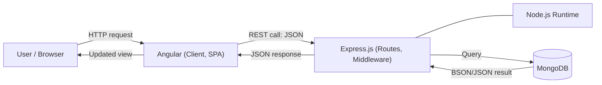

### Advantages of MEAN
1. **One language (JavaScript)** across client, server and database, so one skill set is enough.
2. **JSON everywhere**: no data conversion between layers.
3. **Open source and free**, large community.
4. **Scalable**: Node's non-blocking I/O + MongoDB's horizontal scaling.
5. **Fast development**: reusable modules via npm.

### Limitations
- Not ideal for CPU-heavy tasks (single thread in Node).
- Schema-less MongoDB needs discipline in design.
- AngularJS (1.x) is **end-of-life**; modern projects use Angular 2+.

📝 **EXAM TIP:** Always draw the architecture diagram above in a "What is MEAN stack?" answer. It gets half the marks.

---

# 1. Node.js

## 1.1 Introduction ✅

- **Node.js** is an **open-source, cross-platform server-side runtime** that runs JavaScript outside the browser.
- Built on Google's **V8 engine**. Created by **Ryan Dahl** (2009).
- **Node.js = Runtime Environment + JavaScript Library.**
- Runs on Windows, Linux, Unix, macOS.
- Files have the `.js` extension and must be started on the server (`node app.js`).

**What Node.js can do**
- Generate dynamic page content
- Create, open, read, write, delete and close files on the server
- Collect form data
- Add, delete and modify data in a database

**Where to use Node.js**
- I/O-bound applications
- Data streaming applications
- Data-Intensive Real-time applications (DIRT), e.g. chat
- JSON-API based applications
- Single Page Applications

## 1.2 Features ✅

| Feature | Explanation |
|---|---|
| **Asynchronous and event-driven** | API calls never wait; the server moves to the next request and is notified through events/callbacks |
| **Very fast** | V8 compiles JavaScript to machine code |
| **Single-threaded but highly scalable** | One main thread + event loop handles thousands of connections |
| **No buffering** ⚠️ | Applications output data in **chunks** (streams) instead of buffering the whole response |

⚠️ **CORRECTION:** "No buffering" in the PDF means Node does not *wait to collect* all data. It streams in chunks. Node does have a `Buffer` type (see §1.4).

## 1.3 Architecture and Event Loop 🔴 MISSING NOTE (explanation added)

> [!WARNING]
> Your PDF has only the heading *"Single Threaded Event Loop architecture"* and an image. **Event Loop** is listed on the agenda with **no content**. The following is added.

**Single-Threaded Event Loop Model (point-wise)**
1. Clients send requests to the Node server.
2. Requests enter the **Event Queue**.
3. The **Event Loop** (single thread) picks requests one by one.
4. **Non-blocking (simple) tasks** are processed immediately and the response is returned.
5. **Blocking (I/O) tasks**, such as file or DB access, are handed to the **Thread Pool** (libuv worker threads).
6. When the worker finishes, its **callback** is placed back in the queue.
7. The event loop runs the callback and sends the response.

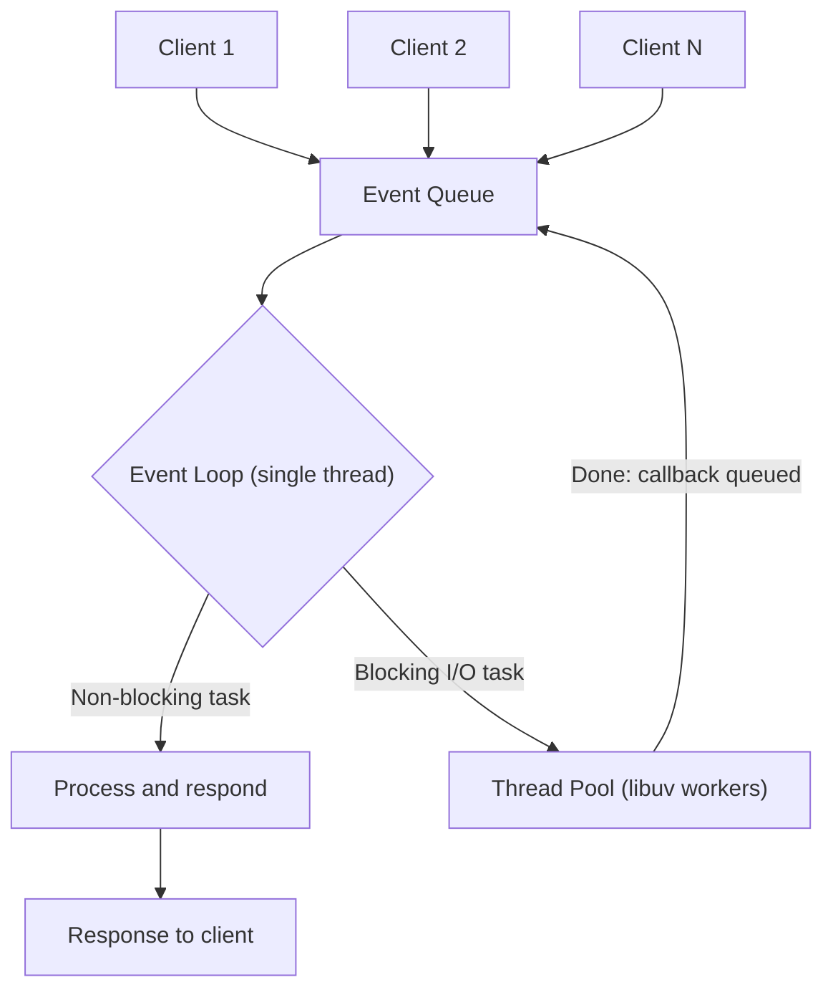

**Event Loop phases (for higher marks):** timers → pending callbacks → poll (I/O) → check (`setImmediate`) → close callbacks. `process.nextTick()` and Promises run between phases.

```js
console.log('1 Start');
setTimeout(() => console.log('3 Timer'), 0);
console.log('2 End');
// Output: 1 Start, 2 End, 3 Timer  (callback runs after current code finishes)
```

🔁 **COMPARE: Traditional (multi-threaded) server vs Node.js**

| Point | Apache + PHP (traditional) | Node.js |
|---|---|---|
| Threading | New thread/process **per request** | **One thread** + event loop |
| I/O model | Blocking | Non-blocking, asynchronous |
| Memory use | High under heavy load | Low |
| Best for | CPU-heavy, simple sites | Real-time, I/O-heavy, APIs |
| Scalability | Limited by thread count | Handles very many concurrent connections |
| Language | PHP | JavaScript |

## 1.4 Node.js Basics ✅

- **Primitive types:** String, Number, Boolean, Undefined, Null, RegExp. Everything else is an object.
- **Loose typing:** `var` can hold any type.
- **Functions are first-class citizens**: they can be stored in variables, passed as arguments and have properties.
- **Buffer:** extra data type (not in browser JS) to store **binary data** (file reads, network packets).
- **`process` object:** gives information about the running Node process (`process.argv`, `process.env`, `process.exit()`).
- **REPL** (Read-Eval-Print-Loop): interactive shell started by typing `node`.

| REPL command | Use |
|---|---|
| `.help` | List commands |
| `.save file` / `.load file` | Save / load session |
| `.break` / `.clear` | Exit multi-line expression |
| `Ctrl+C` twice or `Ctrl+D` | Exit REPL |

```js
var obj = { authorName: 'Ryan Dahl', language: 'Node.js' };   // object literal
function Display(x) { console.log(x); }
Display(100);
```

## 1.5 Modules ✅

**Module** = reusable functionality kept in one or more JS files. Each module has its **own scope**, so it does not pollute global scope. Node follows the **CommonJS** standard.

**Structure of a Node application (3 parts)**
1. **Import** required modules using `require()`
2. **Create server** that listens to client requests
3. **Read request, return response**

### Types of modules

| Type | Description | Example |
|---|---|---|
| **Core** | Built into Node binary. Must still be `require`d | `http`, `fs`, `url`, `path`, `querystring`, `util`, `events` |
| **Local** | Written by you in your project | `./Log.js` |
| **Third-party** | Installed with **npm** | `express`, `mongoose` |

| Core module | Purpose |
|---|---|
| `http` | Create HTTP server |
| `url` | Parse URLs |
| `querystring` | Handle query strings |
| `path` | File-path utilities |
| `fs` | File I/O |
| `util` | Utility functions |

### Creating and exporting a local module
`module.exports` is a special object present in every file. Whatever is assigned to it is exposed.

```js
// Log.js — export an object
var log = {
  info:    function (m) { console.log('Info: ' + m); },
  warning: function (m) { console.log('Warning: ' + m); },
  error:   function (m) { console.log('Error: ' + m); }
};
module.exports = log;
```
```js
// app.js — import it
var myLog = require('./Log.js');   // path is required for local modules
myLog.info('Node.js started');
```

**Ways to export** (all in your PDF)

| What is exported | Code | Use |
|---|---|---|
| Literal | `module.exports = 'Hello world';` | Constant |
| Property on object | `exports.SimpleMessage = 'Hello';` | Several values |
| Object | `module.exports = { firstName:'James', lastName:'Bond' };` | Data |
| Function | `module.exports = function(msg){ console.log(msg); };` | Single utility |
| Function as class | `module.exports = function(f,l){ this.fullName=function(){return f+' '+l;} }` then `new person('James','Bond')` | Reusable object |

🔁 **COMPARE: `exports` vs `module.exports`**

| Point | `exports` | `module.exports` |
|---|---|---|
| What it is | A **shortcut reference** to `module.exports` | The **actual object** returned by `require()` |
| Can attach properties | Yes | Yes |
| Can replace whole export (`= function`) | **No** (breaks the reference) | **Yes** |

🔁 **COMPARE: Core vs Local vs Third-party modules**

| Point | Core | Local | Third-party |
|---|---|---|---|
| Installation | None | None | `npm install` |
| `require` syntax | `require('fs')` | `require('./file')` | `require('express')` |
| Location | Inside Node | Your project | `node_modules/` |
| Maintained by | Node team | You | Community |

## 1.6 URL Module 🔴 MISSING NOTE (added)

> [!WARNING]
> Listed in agenda, but no slide in the PDF. Your HTTP slide uses `url.parse()`, which is covered here.

- The `url` module **splits a URL into readable parts** (host, pathname, query).
- Legacy API: `url.parse(req.url, true)`. Modern API: `new URL()`.

```js
var url = require('url');
var adr = 'http://localhost:8080/default.htm?year=2026&month=october';
var q = url.parse(adr, true);

console.log(q.host);        // localhost:8080
console.log(q.pathname);    // /default.htm
console.log(q.search);      // ?year=2026&month=october
console.log(q.query.month); // october
```
⚠️ `url.parse()` is **deprecated**. Modern equivalent: `const u = new URL(adr); u.searchParams.get('month');`

## 1.7 HTTP Module ✅

- Built-in module to transfer data over **HTTP**.
- `http.createServer(callback)` creates a server. The callback runs on **every request**. `req` is the request and `res` is the response.
- `res.writeHead(status, headers)` sets the status code and headers (`200` = OK).
- `res.write()` sends the body, `res.end()` finishes the response.
- `req.url` holds the part of the URL after the domain.

```js
var http = require('http');
var url  = require('url');

http.createServer(function (req, res) {
  res.writeHead(200, { 'Content-Type': 'text/html' });
  var q = url.parse(req.url, true).query;      // /?year=2026&month=Oct
  res.end(q.year + ' ' + q.month);
}).listen(8080);                                // listen on port 8080
```

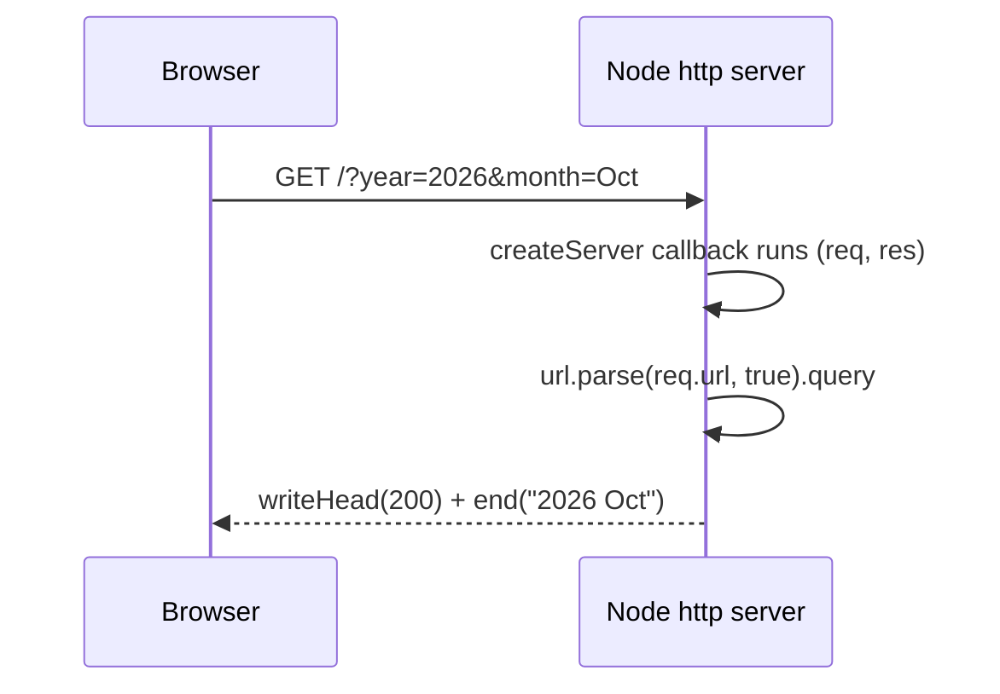

## 1.8 File System (`fs`) Module ✅

Used to **read, create, update, delete and rename** files. Include with `var fs = require('fs');`

| Method | Purpose |
|---|---|
| `fs.readFile(file, [opt], cb)` | Read file asynchronously |
| `fs.writeFile(file, data, [opt], cb)` | Write. **Overwrites** if file exists, else creates |
| `fs.appendFile(file, data, cb)` | Add to end of file |
| `fs.open(path, flags, [mode], cb)` | Open file with a flag |
| `fs.rename(old, new, cb)` | Rename |
| `fs.unlink(path, cb)` | Delete a file |
| `fs.mkdir(path, cb)` | Create directory |
| `fs.readdir(path, cb)` | List directory contents |
| `fs.rmdir(path, cb)` | **Remove** directory |
| `fs.stat(path, cb)` | File statistics |
| `fs.access(path, mode, cb)` | Check permissions |

⚠️ **CORRECTIONS:** (a) PDF says `fs.rmdir` "renames" a directory. It **removes** it. (b) `fs.writeFile` default flag is **`'w'`**, not `'r'`. (c) `fs.exists()` is **deprecated**; use `fs.access()`.

**File flags**

| Flag | Meaning |
|---|---|
| `r` | Read. Error if file missing |
| `r+` | Read + write. Error if missing |
| `w` | Write. Creates or **truncates** |
| `wx` | Like `w`, fails if exists |
| `w+` | Read + write, creates or truncates |
| `a` | **Append**. Creates if missing |
| `ax` | Like `a`, fails if exists |
| `a+` | Read + append |

```js
var fs = require('fs');
fs.writeFile('college.txt', 'Fergusson College', function (err) {
  if (err) throw err;
  fs.readFile('college.txt', 'utf8', function (err, data) {
    console.log(data);                 // Fergusson College
  });
});
```

🔁 **COMPARE: Synchronous vs Asynchronous file methods**

| Point | `fs.readFileSync` | `fs.readFile` |
|---|---|---|
| Blocks event loop | **Yes** | **No** |
| Result | Returned directly | Passed to callback |
| Error handling | `try / catch` | `err` argument in callback |
| Use | Start-up scripts, config load | Servers, handling requests |

## 1.9 Callbacks ✅

- A **callback** is a function passed as an argument and **called when a task completes**. It is the asynchronous equivalent of a normal return.
- Node APIs are written to accept callbacks, so the program does not wait for I/O.
- Convention: **error-first callback** `function (err, data)`.

🔁 **COMPARE: Blocking vs Non-blocking code**

| Point | Blocking | Non-blocking (callback) |
|---|---|---|
| Execution | Next line waits | Next line runs immediately |
| Example | `fs.readFileSync` | `fs.readFile` + callback |
| Throughput | Low | High |

```js
// Non-blocking
fs.readFile('input.txt', function (err, data) { console.log(data.toString()); });
console.log('Program ended');   // prints FIRST
```

## 1.10 EventEmitter ✅

- Node is event-driven. The **`events`** module provides the **`EventEmitter`** class to create and handle **custom events**.
- `on()` binds a listener, `emit()` fires the event.

```js
var events = require('events');
var em = new events.EventEmitter();

em.on('greet', function (name) { console.log('Hello ' + name); });   // listener
em.emit('greet', 'Asha');                                            // fire
```

| Method | Description |
|---|---|
| `addListener(e, fn)` / `on(e, fn)` | Add listener at end of list |
| `once(e, fn)` | Listener runs **only once**, then removed |
| `removeListener(e, fn)` | Remove one listener |
| `removeAllListeners([e])` | Remove all |
| `setMaxListeners(n)` | Default warning above 10 listeners |
| `listeners(e)` | Array of listeners |
| `emit(e, args)` | Run listeners. Returns `true` if any existed |

**Built-in events:** `newListener` (listener added), `removeListener` (listener removed), `error`.

**Two patterns:** (1) return an EventEmitter from a function, (2) **extend** the EventEmitter class.

🔁 **COMPARE: `on()` vs `once()`**: `on` fires every time the event is emitted; `once` fires only the first time.

## 1.11 Uploading Files 🔴 MISSING NOTE (added)

> [!WARNING]
> Listed in agenda, no slide in the PDF.

**Steps (point-wise)**
1. Create an HTML form with `method="post"` and `enctype="multipart/form-data"`.
2. Install a parser module: **`formidable`** (or `multer` with Express).
3. Parse the incoming request on the server.
4. Move the file from the temp folder to the target folder using `fs.rename` / `fs.copyFile`.

```js
var http = require('http'), formidable = require('formidable'), fs = require('fs');

http.createServer(function (req, res) {
  if (req.url == '/upload' && req.method.toLowerCase() == 'post') {
    var form = new formidable.IncomingForm();
    form.parse(req, function (err, fields, files) {
      // files.filetoupload holds temp path; move it to permanent folder
      res.write('File uploaded'); res.end();
    });
  } else {
    res.writeHead(200, { 'Content-Type': 'text/html' });
    res.write('<form action="/upload" method="post" enctype="multipart/form-data">' +
              '<input type="file" name="filetoupload"><input type="submit"></form>');
    res.end();
  }
}).listen(8080);
```

## 1.12 Streams ✅

A **stream** reads data from a source and writes to a destination **piece by piece**, so large files do not fill memory.

| Type | Purpose |
|---|---|
| **Readable** | Read operations (`fs.createReadStream`) |
| **Writable** | Write operations (`fs.createWriteStream`) |
| **Duplex** | Both read and write (e.g. TCP socket) |
| **Transform** | Duplex where output is computed from input (e.g. compression) |

**Events:** `data` (chunk available), `end` (no more data), `error`, `finish` (all data flushed). Every stream is an EventEmitter.

```js
var fs = require('fs');
var r = fs.createReadStream('input.txt');  r.setEncoding('UTF8');
var w = fs.createWriteStream('output.txt');
r.on('data',  function (chunk) { w.write(chunk); });
r.on('end',   function () { w.end(); });
r.on('error', function (err) { console.log(err.stack); });
// shortcut: r.pipe(w);
```

🔁 **COMPARE: `readFile` vs `createReadStream`**

| Point | `readFile` | `createReadStream` |
|---|---|---|
| Loads | Entire file into memory | In small chunks |
| Large files | Poor | Good |
| Starts output | After full read | Immediately |

## 1.13 Debugging (brief) ✅

- Add the `debugger;` statement in code.
- Run `node inspect app.js`. Commands: `next`, `cont`, `step`, `out`, `watch('expr')`, `pause`.
- GUI option: Chrome DevTools via `node --inspect app.js`, or the built-in IDE debugger (VS Code).

⚠️ `node debug` and the `node-inspector` package in your PDF are **obsolete**. Use `node inspect` / `--inspect`.

📝 **EXAM TIP:** Debugging is a 2–3 mark topic. Do not write more than this.

---

# 2. Express.js 🔴 MISSING IN YOUR NOTES

> [!WARNING]
> Your `nodejs.pdf` has **one slide** on Express (definition + 4 features). Routing, middleware, installation and a REST example are **not in your PDFs**. Express is the **"E" of MEAN**, so it is almost certain to be asked. Everything below the ✅ line is added.

## 2.1 Introduction ✅

- **Express** is a flexible, minimal **web application framework built on top of Node.js**. It helps manage the server and routes.
- Install: `npm install express`

**Core features (from your PDF)**
1. Designs **single-page, multi-page and hybrid** web applications.
2. Sets up **middleware** to respond to HTTP requests.
3. Defines a **routing table** that performs actions based on **HTTP method + URL**.
4. Dynamic rendering of HTML pages by passing arguments to **templates**.

## 2.2 Hello World 🔴

```js
const express = require('express');
const app = express();

app.get('/', (req, res) => res.send('Hello World'));
app.listen(3000, () => console.log('Server on port 3000'));
```

## 2.3 Routing 🔴

**Routing** = deciding which code runs for a given **HTTP method and URL path**.
Syntax: `app.METHOD(PATH, HANDLER)`

| HTTP method | Express | CRUD meaning |
|---|---|---|
| GET | `app.get()` | Read |
| POST | `app.post()` | Create |
| PUT / PATCH | `app.put()` | Update |
| DELETE | `app.delete()` | Delete |

```js
app.get('/students/:id', (req, res) => {
  res.json({ id: req.params.id });          // route parameter
});
app.post('/students', (req, res) => {
  res.status(201).json(req.body);           // needs express.json() middleware
});
```

## 2.4 Middleware 🔴

**Middleware** = functions with access to `req`, `res` and `next()`. They run **in order** between request and response.

**Uses:** logging, parsing JSON body, authentication, error handling, serving static files.

```js
app.use(express.json());                       // built-in: parse JSON body
app.use(express.static('public'));             // serve static files
app.use((req, res, next) => {                  // custom logger
  console.log(req.method, req.url);
  next();                                      // pass control onward
});
```

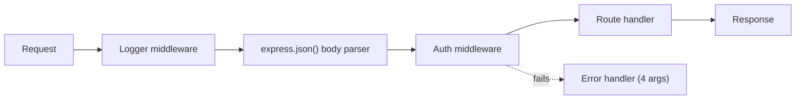

## 2.5 Types of middleware 🔴
1. **Application-level** (`app.use`)
2. **Router-level** (`router.use`)
3. **Built-in** (`express.json`, `express.static`)
4. **Third-party** (`cors`, `morgan`, `cookie-parser`)
5. **Error-handling** (`(err, req, res, next)`)

🔁 **COMPARE: Plain Node `http` vs Express**

| Point | Node `http` module | Express |
|---|---|---|
| Routing | Manual `if (req.url == ...)` | `app.get()`, `app.post()` |
| Body parsing | Manual stream handling | `express.json()` |
| Middleware | Not available | Built-in concept |
| Static files | Write code yourself | `express.static()` |
| Template engines | None | Pug, EJS, Handlebars |
| Code size | Long | Short |
| Level | Low-level core module | Framework on top |

---

# 3. MongoDB

## 3.1 NoSQL Introduction ✅

- **NoSQL** = "non-SQL / non-relational" database for large volumes of **structured, semi-structured and unstructured** data, not stored in fixed tables.
- **Why NoSQL arose:** data changes shape quickly (polymorphic), applications are distributed and cloud-based, and serve thousands of users across time zones.

**Structured vs Unstructured data**

| Point | Structured | Unstructured |
|---|---|---|
| Format | Fixed, tabular | Free (documents, images, video) |
| Example | Bank table | Photos, emails |
| Processing | Easy with data-mining tools | Slow to extract meaning |

**Types of NoSQL databases**

| Type | Idea | Example |
|---|---|---|
| **Document** | Key paired with a document | **MongoDB**, CouchDB |
| **Key-Value** | Unstructured value stored with a key | Redis |
| **Graph** | Networked / related data | Neo4j |
| **Wide-column** | Very large data sets | Cassandra, HBase |

**Benefits of NoSQL:** handles all data types · agile development, rapid iteration · fits object-oriented programming · cheaper, horizontally scalable.

🔁 **COMPARE: SQL vs NoSQL** ✅ (very frequently asked, 5–8 marks)

| # | Point | SQL (RDBMS) | NoSQL |
|---|---|---|---|
| 1 | Type | Relational | Non-relational / distributed |
| 2 | Schema | Fixed, predefined | **Dynamic** |
| 3 | Data shape | Tables (rows, columns) | Documents, key-value, graph, wide-column |
| 4 | Scaling | **Vertical** (bigger server) | **Horizontal** (more servers) |
| 5 | Query language | Structured Query Language | Varies by database (e.g. MongoDB query API) |
| 6 | Complex queries / joins | Very good | Weaker |
| 7 | Hierarchical data | Not ideal | **Best suited** |
| 8 | Examples | MySQL, Oracle, SQLite, PostgreSQL, MS-SQL | MongoDB, Cassandra, Redis, Neo4j, HBase, CouchDB |

## 3.2 MongoDB Introduction ✅

- **MongoDB** is an open-source, **document-oriented NoSQL database** that stores data as JSON-style documents (BSON).
- Developed by **10gen** (now **MongoDB Inc.**), started 2007, open source from 2009.

**Features / Advantages**
1. **Document-oriented** storage (JSON-style), readable.
2. **Replication** and **high availability**.
3. **Auto-sharding** (horizontal scaling).
4. **Ad hoc queries**: range queries, field search, regex.
5. **Indexing** on any field improves search speed.
6. Rich query language and fast updates.
7. Integrates with many programming languages.

**Basic terms**

| Term | Meaning |
|---|---|
| **Database** | Physical container for collections |
| **Collection** | Group of documents (like a table). **No fixed schema** |
| **Document** | Set of key-value pairs with dynamic schema (like a row) |
| **Field** | Key-value pair inside a document (like a column) |

🔁 **COMPARE: RDBMS vs MongoDB terminology**

| RDBMS | MongoDB |
|---|---|
| Database | Database |
| Table | **Collection** |
| Row / Tuple | **Document** |
| Column | **Field** |
| Table join | **Embedded documents** |
| Primary key | `_id` (auto `ObjectId`) |
| `mysqld` / Oracle | `mongod` |

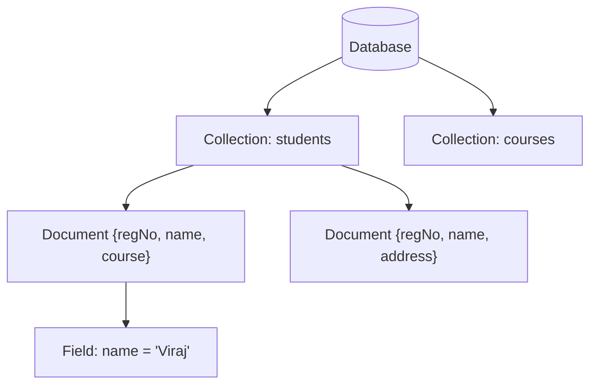

**Document example** (same collection, **different fields allowed**)
```js
{ FirstName: "John", Address: "Delas", Spouse: [{ Name: "Angela" }] }
{ FirstName: "John", Address: "Wick" }
```

### JSON vs BSON ✅

| Point | JSON | BSON |
|---|---|---|
| Full form | JavaScript Object Notation | Binary JSON |
| Format | Text | **Binary-encoded** |
| Data types | Few (string, number, boolean, array, object, null) | **Extra types**: Date, ObjectId, Int32/64, Binary |
| Speed | Slower to parse | Fast to encode/decode |
| Used by | APIs, config | **MongoDB storage and network transfer** |

## 3.3 Installation 🔴 MISSING NOTE (added)

> [!WARNING]
> Agenda lists "Installation" but there is no slide.

1. Download **MongoDB Community Server** from mongodb.com and run the installer (Windows: choose *Complete*, install as a service).
2. Optionally install **MongoDB Compass** (GUI) and **mongosh** (shell).
3. Create the data folder (default `C:\data\db` or `/data/db`).
4. Start the server: **`mongod`** (listens on port **27017**).
5. Open a second terminal and start the shell: **`mongosh`**.
6. Check with `show dbs`.

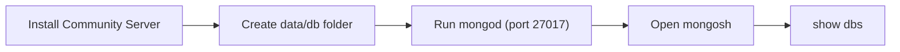

## 3.4 Data Modelling ✅

MongoDB has a **flexible schema**: collections do not enforce document structure. The challenge is balancing **application needs, database performance and data-retrieval patterns**.

**Design rules**
1. Design the schema **according to user requirements**.
2. **Join on write, not on read.**
3. Combine objects that are **used together** into one document.
4. **Optimise for the most frequent use case.**
5. Do complex aggregation in the schema.
6. **Duplicate data within limits**: disk is cheaper than compute time.

### Two data models

**(a) Embedded (de-normalised)** — related data inside one document
```js
{
  _id: 1, Emp_ID: "10025AE336",
  Personal_details: { First_Name: "Radhika", Last_Name: "Sharma", Date_Of_Birth: "1995-09-26" },
  Contact: { email: "radhika@gmail.com", phone: "9848022338" },
  Address: { city: "Hyderabad", Area: "Madapur", State: "Telangana" }
}
```

**(b) Normalised (referenced)** — separate documents linked by `_id`
```js
Employee:         { _id: ObjectId101, Emp_ID: "10025AE336" }
Personal_details: { _id: ObjectId102, empDocID: "ObjectId101", First_Name: "Radhika" }
Contact:          { _id: ObjectId103, empDocID: "ObjectId101", phone: "9848022338" }
```

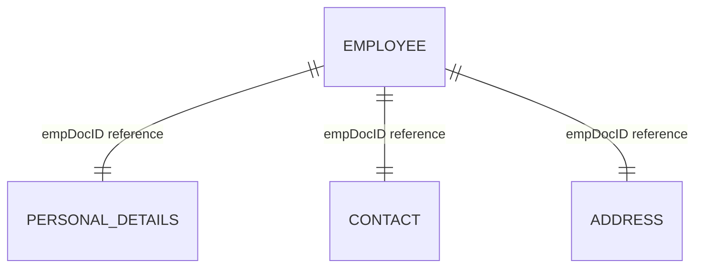

🔁 **COMPARE: Embedded vs Normalized model**

| Point | Embedded | Normalized (reference) |
|---|---|---|
| Structure | One document | Many documents linked by id |
| Read speed | **Fast** (one query) | Slower (multiple queries / lookup) |
| Write/update | Larger document rewrite | Update one small document |
| Duplication | Possible | Minimal |
| Best for | "Contains" relationship, read-heavy | Many-to-many, data shared widely |
| Document-size risk | Can hit 16 MB limit | Avoided |

**Worked example: Blog post** ✅ (RDBMS needs **3 tables**: post, tags, comments. MongoDB needs **1 collection**.)
```js
{
  _id: POST_ID, title: "TITLE", description: "TEXT", by: "PUBLISHER",
  url: "URL", tags: ["tag1", "tag2"], likes: 10,
  comments: [
    { user: "A", message: "Nice", dateCreated: "2026-10-01", like: 2 },
    { user: "B", message: "Good", dateCreated: "2026-10-02", like: 0 }
  ]
}
```

## 3.5 Database, Collection and Data Types ✅

| Task | Command | Note |
|---|---|---|
| Create / switch DB | `use my_project_db` | DB is **created only when first data is saved** |
| Current DB | `db` | |
| List DBs | `show dbs` | Empty DBs are hidden |
| Drop DB | `db.dropDatabase()` | Must be inside that DB |
| Create collection | `db.createCollection("name", options)` | Usually **auto-created** on first insert |
| Drop collection | `db.collection.drop()` | Removes its indexes also |

**`createCollection` options**

| Option | Type | Meaning |
|---|---|---|
| `capped` | Boolean | Fixed-size collection; **oldest entries overwritten** when full |
| `size` | Number | Max bytes (**required** if capped) |
| `max` | Number | Max documents in capped collection |
| `autoIndexId` | Boolean | Auto index on `_id` |

⚠️ **CORRECTION:** PDF says `autoIndexId` default is `false`. In MongoDB the `_id` index is **always created** (the option is deprecated).

**BSON data types**

| Type | Example |
|---|---|
| Integer (32/64-bit) | `{"n": 62}` |
| Double | `{"pi": 3.1415}` |
| Boolean | `{"indian": true}` |
| String | `{"msg": "text"}` |
| Array | `{"degrees": ["BCA","MCA"]}` |
| Object (embedded doc) | `{"Marks": {"Maths": 80}}` |
| Date | `{"d": new Date()}` / `ISODate()` |
| ObjectId | Auto `_id` (12-byte unique id) |

⚠️ Date is stored as **milliseconds since Unix epoch** (64-bit), not "UNIX time" seconds.

## 3.6 CRUD Operations ✅

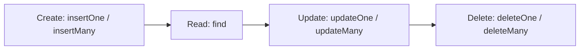

### Create (Insert)
```js
db.student.insertOne({ regNo: "3014", name: "Test Student",
   course: { courseName: "MCA", duration: "3 Years" },
   address: { city: "Bangalore", state: "KA" } })

db.movie.insertMany([{ name: "Avengers: Infinity War" }, { name: "Avengers: Endgame" }])
```

### Read
```js
db.student.find()                          // all documents
db.student.find({ regNo: "3014" })         // with condition
db.student.find().pretty()                 // formatted output
```
Every document gets a unique **`_id` (ObjectId)** automatically.

### Update
```js
db.student.updateOne({ regNo: "3014" }, { $set: { name: "Viraj" } })
```
⚠️ **CORRECTION:** The PDF writes `update({regNo}, $set: {...})` (missing braces). Correct form: `update(filter, { $set: {...} })`. Without `$set` the whole document is **replaced**.

### Delete
```js
db.student.deleteOne({ regNo: "3014" })
db.programmers.deleteMany({ name: { $in: ["Dennis Ritchie", "Bjarne Stroustrup"] } })
db.programmers.remove({})                  // empty filter removes ALL documents
```

🔁 **COMPARE: Insert methods**

| Method | Inserts | Input | Status |
|---|---|---|---|
| `insert()` | One or many | Doc or array | **Deprecated** |
| `insertOne()` | **One** | Document | Current |
| `insertMany()` | **Many** | Array of documents | Current |

🔁 **COMPARE: Delete methods**

| Method | Deletes | Status |
|---|---|---|
| `deleteOne(filter)` | **First** matching document only (even if many match) | Current |
| `deleteMany(filter)` | **All** matching documents | Current |
| `remove(filter)` | One or all | **Deprecated** |

## 3.7 Query Operators, Projection, Limit, Skip, Sort ✅

**Comparison operators**

| Operator | Meaning | Example |
|---|---|---|
| `$eq` | Equal | `{age: {$eq: 22}}` |
| `$ne` | Not equal | |
| `$gt` / `$gte` | Greater / greater or equal | `{student_id: {$gt: 2002}}` |
| `$lt` / `$lte` | Less / less or equal | |
| `$in` | Matches any value in array | `{name: {$in: ["A","B"]}}` |
| `$nin` | Matches none in array | |

**Logical operators:** `$and` (both true), `$or` (either), `$nor` (neither), `$not` (invert).
```js
db.studentdata.find({ $or: [{ student_age: 22 }, { student_id: { $gt: 2003 } }] })
```

**Array operators:** `$all` (contains all listed values), `$size` (array has n elements), `$elemMatch` (one array element satisfies all conditions).

**Projection** — choose which fields to return (`1` = show, `0` = hide)
```js
db.writers.find({ author: "Gaurav Mandes" }, { _id: 0, author: 1, title: 1 })
```

**Limit and Skip**
```js
db.studentdata.find({ student_id: { $gt: 2002 } }).limit(1)          // first 1 result
db.studentdata.find({ student_id: { $gt: 2002 } }).limit(1).skip(1)  // skip 1, then take 1
```
`limit(n)` = max n documents. `skip(n)` = ignore the first n. Together they give **pagination**.

**Sort** — `1` = ascending (default), `-1` = descending
```js
db.techSubjects.find({}, { topic: 1, _id: 0 }).sort({ topic: 1 })    // A to Z
db.techSubjects.find({}, { topic: 1, _id: 0 }).sort({ topic: -1 })   // Z to A
```

## 3.8 Aggregation ✅

- **Aggregation** processes data from many documents and returns a **calculated result** (sum, average, min, max, count).
- Equivalent of SQL `GROUP BY` + `COUNT(*)`.
- Method: `db.collection.aggregate([ stage1, stage2, ... ])`

**Three ways**
1. **Aggregation pipeline** (preferred)
2. **Map-reduce** (older, deprecated)
3. **Single-purpose methods** (`count`, `distinct`)

| Expression | Meaning |
|---|---|
| `$sum` | Total (use `1` to count) |
| `$avg` | Average |
| `$min` / `$max` | Smallest / largest |
| `$push` | Add values to an array |
| `$addToSet` | Add to array **without duplicates** |
| `$first` / `$last` | First / last document in group |

```js
// Count books per author
db.writers.aggregate([
  { $group: { _id: "$author", TotalBooksWritten: { $sum: 1 } } }
])
```

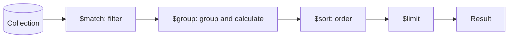

```js
db.sales.aggregate([
  { $match: { status: "paid" } },
  { $group: { _id: "$city", total: { $sum: "$amount" } } },
  { $sort: { total: -1 } }
])
```

## 3.9 Indexing ✅

- An **index** is a special data structure that stores a **small part of each document** (selected fields) so searches avoid scanning the whole collection.
- Benefit: **faster reads**. Cost: **slower insert/update/delete** and extra space.

| Task | Command |
|---|---|
| Create | `db.studentdata.createIndex({ student_name: 1 })` (1 asc, -1 desc) |
| List | `db.studentdata.getIndexes()` |
| Drop one | `db.studentdata.dropIndex({ student_name: 1 })` |
| Drop all | `db.studentdata.dropIndexes()` |
| Array field | `db.users.createIndex({ tags: 1 })` (one entry **per element**) |
| Sub-document fields | `db.users.createIndex({ "location.city": 1, "location.country": 1 })` |

⚠️ `ensureIndex()` in the PDF is **deprecated**; use `createIndex()`.

**Limitations**
1. **Extra overhead**: space and write cost. Useless on rarely-read collections.
2. **RAM usage**: indexes should fit in RAM; otherwise performance drops.
3. **Query limits**: index not used effectively with regex, negation (`$nin`, `$not`), `$where`, arithmetic (`$mod`).

## 3.10 Replication, Sharding, Storage, Change Streams 🔴 MISSING NOTE (added)

> [!WARNING]
> Listed in the Mongo II agenda but **no slides exist**. Short exam-ready notes below.

**Replication** — keeping the **same data on multiple servers** for high availability.
- A **replica set** has **one Primary** (all writes) and **multiple Secondaries** (copy data from primary).
- If the primary fails, an **automatic election** picks a new primary (**failover**).
- Benefits: no single point of failure, data redundancy, read scaling.

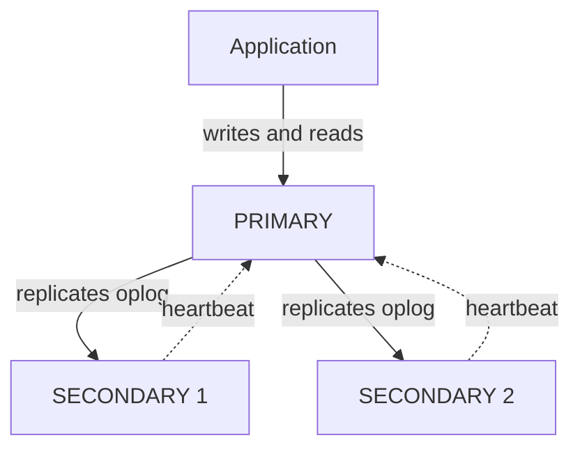

**Sharding** — splitting data **across servers** (horizontal scaling). Uses a **shard key**; `mongos` routes queries; config servers hold metadata.

🔁 **COMPARE: Replication vs Sharding**

| Point | Replication | Sharding |
|---|---|---|
| Purpose | **Availability**, redundancy | **Scalability** for huge data |
| Data on each server | **Full copy** | **Part** of data |
| Failure handling | Auto failover | Needs replicas per shard |
| Writes | Only primary | Spread across shards |

**Storage engine** — component that manages how data is stored on disk and in memory. Default is **WiredTiger** (document-level locking, compression, journaling). Older: MMAPv1.

**Change Streams** — let applications **listen to real-time data changes** (insert, update, delete) in a collection without polling. Needs a replica set.
```js
const cs = db.orders.watch();
cs.on('change', c => console.log(c.operationType));
```

## 3.11 MongoDB Comparison Summary 🔁

| Aspect | Option A | Option B |
|---|---|---|
| `find()` vs `aggregate()` | Filter, project, sort | Group, compute, multi-stage transform |
| Capped vs normal collection | Fixed size, overwrite oldest, insertion order kept | Grows freely |
| Index vs no index | Fast read, slower write | Slow read (full scan), fast write |
| `limit()` vs `skip()` | How many to return | How many to ignore first |

---

# 4. AngularJS

> [!NOTE]
> Your PDFs teach **AngularJS 1.x** (uses `$scope`, `ng-` directives, `$routeProvider`). It is the version your syllabus follows, so answer in that style. Differences from modern Angular are in §4.17.

## 4.1 Introduction ✅

- **AngularJS** is an open-source **JavaScript framework by Google** for building **Rich Internet Applications (RIA)** and **Single Page Applications (SPA)**.
- Extends HTML with new attributes (**directives**, prefix `ng-`).
- Follows an **MVC / MVVM (MVW)** style; **two-way data binding**.
- Cross-browser, free, licensed under **Apache 2.0**.
- Added to a page with a script tag:
```html
<script src="https://ajax.googleapis.com/ajax/libs/angularjs/1.6.9/angular.min.js"></script>
```

## 4.2 Features ✅

| Feature | Explanation |
|---|---|
| **Data binding** | Automatic synchronisation between model and view |
| **Scope** | Object that refers to the model; **glue between controller and view** |
| **Controller** | JavaScript function bound to a scope |
| **Services** | Singleton objects (e.g. `$http`) created **once per app** |
| **Filters** | Transform or select data (`uppercase`, `orderBy`) |
| **Directives** | Markers on DOM elements (`ng-model`, `ng-bind`) that create custom behaviour/tags |
| **Templates** | Rendered view (HTML + bindings) |
| **Routing** | Switching views without page reload |
| **Deep linking** | Application state encoded in URL, can be bookmarked |
| **Dependency Injection** | Framework supplies required objects to a component |
| **Testability** | Designed for unit and end-to-end testing |

## 4.3 Advantages and Disadvantages ✅

| Advantages | Disadvantages |
|---|---|
| Builds **SPA** cleanly | **Not secure alone**: server-side authentication/authorisation required |
| **Two-way data binding** gives responsive UI | **Not degradable**: if JavaScript is disabled, nothing shows |
| **Unit-testable** code | Heavy watchers slow big pages (digest cycle) |
| **Dependency Injection**, separation of concerns | Version 1.x is **end-of-life** ⚠️ |
| **Reusable components** (directives) | |
| Less code for more functionality | |
| Views are plain HTML | |
| Runs on all major browsers and mobile | |

## 4.4 MVC Architecture ✅

**MVC** separates **application logic from the user interface** (separation of concerns).

| Part | Responsibility |
|---|---|
| **Model** | Stores and manages data, rules and logic |
| **View** | What the user sees (output representation) |
| **Controller** | Accepts input, converts it to commands for model/view |

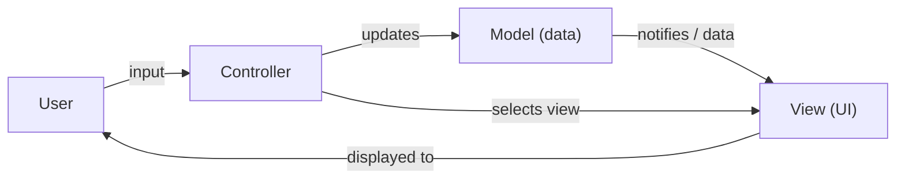

## 4.5 MVVM Pattern ✅

- Derived from MVC. Separates UI development from business logic.
- **View knows ViewModel; ViewModel knows Model; Model knows neither.**
- **ViewModel** is the intermediary: it reformats model data for the view and handles view logic (e.g. a button click triggers a command).

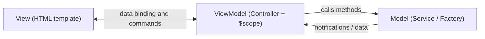

**MVVM in AngularJS**

| MVVM part | AngularJS implementation |
|---|---|
| Model | **Service / Factory** |
| View | **Template** (HTML with bindings) in `ng-view` |
| ViewModel | **Controller** (`ng-controller`) with `$scope` |

**Benefits:** developers and designers work **in parallel**; view model and model can be **unit-tested without the view**; UI can be redesigned without touching logic.

🔁 **COMPARE: MVC vs MVVM**

| Point | MVC | MVVM |
|---|---|---|
| Middle layer | **Controller** | **ViewModel** |
| Communication | Controller updates model and view | **Data binding** syncs view ↔ viewmodel |
| View awareness | View may read model directly | View talks only to ViewModel |
| Testing UI logic | Harder | Easier |
| AngularJS fit | Partly | **Closer** (AngularJS = "MV-Whatever") |

## 4.6 Directives ✅

Directives are **extended HTML attributes** prefixed with `ng-`.

| Directive | Purpose |
|---|---|
| `ng-app` | Defines the **root** of the app and bootstraps it |
| `ng-init` | Initialises application data |
| `ng-model` | Binds an input control to application data |
| `ng-bind` | Binds application data to an HTML tag |
| `ng-repeat` | Repeats an element for each item in a collection |
| `ng-controller` | Attaches a controller |
| `ng-click` | Click event handler |
| `ng-show` / `ng-hide` | Show / hide element |
| `ng-disabled` | Binds data to `disabled` attribute |
| `ng-options` | Builds `<select>` options from an array |
| `ng-include` / `ng-view` | Loads a template / route view |

```html
<div ng-app="" ng-init="names=[{name:'J',country:'Norway'},{name:'K',country:'Sweden'}]">
  <p>Name: <input type="text" ng-model="name"></p>
  <p ng-bind="name"></p>
  <ul><li ng-repeat="x in names">{{ x.name + ', ' + x.country }}</li></ul>
</div>
```

**What happens when the page loads (7 steps)**
1. Browser loads and evaluates the HTML.
2. AngularJS file loads, global `angular` object is created.
3. Controller functions are registered.
4. AngularJS scans HTML for apps and views.
5. View is connected to its controller.
6. Controller executes.
7. View is rendered with model data, page ready.

## 4.7 Expressions ✅

- Written inside **`{{ expression }}`**. Bind data to HTML like `ng-bind`.
- Can use numbers, strings, objects, arrays.

```html
<div ng-app="" ng-init="quantity=1; cost=30; student={firstname:'Mahesh',lastname:'Parashar',rollno:101}; marks=[80,90,75,73,60]">
  <p>Hello {{ student.firstname + " " + student.lastname }}!</p>
  <p>Expense on Books: {{ cost * quantity }} Rs</p>
  <p>Roll No: {{ student.rollno }}</p>
  <p>Marks (Math): {{ marks[3] }}</p>
</div>
<!-- Output: Hello Mahesh Parashar! / 30 Rs / 101 / 73 -->
```

🔁 **COMPARE: AngularJS expressions vs JavaScript expressions**

| Point | AngularJS expression | JavaScript expression |
|---|---|---|
| Written in | **HTML** (`{{ }}`) | JS code |
| Conditionals, loops, exceptions | **Not supported** | Supported |
| Filters (`\| uppercase`) | **Supported** | Not supported |
| Error handling | Forgiving (undefined shows blank) | Throws error |

## 4.8 Module, Controller and Scope ✅

- **Module** = container that defines an application. `angular.module('myApp', [])`
- **Controller** = JavaScript function that controls data flow; takes **`$scope`** as parameter.
- **`$scope`** = **the Model**. A JavaScript object whose properties/methods are available to both **view and controller**.

```html
<div ng-app="myApp" ng-controller="myCtrl">
  First Name: <input type="text" ng-model="firstName"><br>
  Last Name:  <input type="text" ng-model="lastName"><br>
  Full Name: {{ firstName + " " + lastName }}
</div>
<script>
  var app = angular.module('myApp', []);
  app.controller('myCtrl', function ($scope) {
    $scope.firstName = "John";
    $scope.lastName  = "Doe";
  });
</script>
```

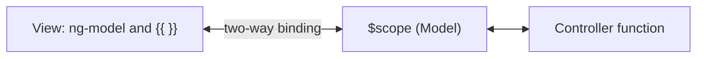

## 4.9 Two-Way Data Binding ✅

- Change in **view** (user types) → **model** updates. Change in **model** (code) → **view** updates. Automatically.
- Achieved by `ng-model` plus the **digest cycle** (§4.12).

🔁 **COMPARE: One-way vs Two-way binding**

| Point | One-way | Two-way (AngularJS) |
|---|---|---|
| Direction | Model → View only | Model ↔ View |
| Example | `{{ name }}` / `ng-bind` | `ng-model` |
| Use | Display | Forms / input |

## 4.10 Filters ✅

A **filter** transforms data for display. Use the **pipe `|`** in expressions or directives.

| Filter | Purpose | Example |
|---|---|---|
| `currency` | Currency format | `{{ price \| currency }}` |
| `date` | Date format | `{{ d \| date:'dd-MM-yyyy' }}` |
| `filter` | Select subset of an **array** | `ng-repeat="x in names \| filter:'i'"` |
| `json` | Object → JSON string | |
| `limitTo` | Limit characters/items | |
| `lowercase` / `uppercase` | Case change | `{{ lastName \| uppercase }}` |
| `number` | Number → string | |
| `orderBy` | Sort array | `ng-repeat="x in names \| orderBy:'country'"` |

## 4.11 Services ✅

- A **service** is a function/object **available to and limited to your AngularJS app**. About **30 built-in** services. They are **singletons** (created once).
- Services are **injected** by listing them as controller arguments (**Dependency Injection**).
- **Why `$location` and not `window.location`?** AngularJS must watch changes to stay in sync, so it needs its own wrapper.

| Service | Purpose | Plain JS equivalent |
|---|---|---|
| `$location` | Info about current URL | `window.location` |
| `$http` | Make server (XHR/AJAX) requests, handle response | `XMLHttpRequest` |
| `$timeout` | Run function **once after delay** | `setTimeout` |
| `$interval` | Run function **repeatedly** at interval | `setInterval` |

```js
app.controller('myCtrl', function ($scope, $http, $timeout, $interval) {
  // GET request
  $http.get('welcome.htm').then(function (response) { $scope.myWelcome = response.data; });

  // run once after 2 seconds
  $timeout(function () { $scope.myHeader = "How are you today?"; }, 2000);

  // run every 1 second
  $interval(function () { $scope.theTime = new Date().toLocaleTimeString(); }, 1000);
});
```

**Custom service (to build your own Model)** 🔴 *(only built-in services are in your PDF)*
```js
app.service('StudentService', function ($http) {
  this.getAll = function () { return $http.get('/api/students'); };
});
app.controller('stuCtrl', function ($scope, StudentService) {
  StudentService.getAll().then(function (r) { $scope.students = r.data; });
});
```

🔁 **COMPARE: `$timeout` vs `$interval`**

| Point | `$timeout` | `$interval` |
|---|---|---|
| Runs | **Once** | **Repeatedly** |
| Plain JS | `setTimeout` | `setInterval` |
| Use case | Show message after 2 s | Clock updating every second |
| Stop | Auto | `$interval.cancel()` |

🔁 **COMPARE: `$location` vs `window.location`**: `$location` is integrated with the digest cycle (changes are tracked and the view updates); `window.location` is not tracked by AngularJS.

## 4.12 Events ✅

AngularJS **event directives** attach custom code to DOM events: `ng-click`, `ng-dblclick`, `ng-change`, `ng-blur`, `ng-focus`, `ng-keydown`, `ng-keyup`, `ng-keypress`, `ng-mouseover`, `ng-mouseenter`, `ng-mouseleave`, `ng-copy`, `ng-cut`, `ng-paste`, etc.

```html
<!-- ng-click -->
<button ng-click="count = count + 1" ng-init="count=0">Increment</button>
<div>Current Count: {{count}}</div>

<!-- ng-disabled -->
<div ng-init="mySwitch=true">
  <button ng-disabled="mySwitch">Click Me!</button>
  <input type="checkbox" ng-model="mySwitch"> Disable button
</div>

<!-- ng-show: hidden at start, shown on click -->
<div ng-controller="DemoController">
  <input type="button" value="Show" ng-click="ShowHide()">
  <div ng-show="IsVisible">Angular</div>
</div>
```
Both `ng-show` and `ng-hide` work by **adding/removing the CSS class `.ng-hide`** (element stays in the DOM).

🔁 **COMPARE: `ng-show` vs `ng-hide`**

| Point | `ng-show` | `ng-hide` |
|---|---|---|
| Element visible when expression is | **true** | **false** |
| Hidden when expression is | false | **true** |
| Mechanism | Toggles `.ng-hide` class | Toggles `.ng-hide` class |
| DOM presence | Stays in DOM | Stays in DOM |

(`ng-if` removes the element from the DOM completely.)

## 4.13 Forms and Validation ✅

- Forms give **data binding** (`ng-model`) and **client-side validation**.
- Controls: `input`, `select`, `textarea`, `button`. Checkbox → true/false; radio buttons share one `ng-model`; select binds to chosen option.
- ⚠️ **Client-side validation alone is not secure**; **server-side validation is also required**.

**State properties** (access as `formName.inputName.$property`)

| Property | True when |
|---|---|
| `$valid` / `$invalid` | Input is valid / invalid |
| `$pristine` | User has **not** modified |
| `$dirty` | User **has** modified |
| `$touched` | User has left (tabbed out of) the field |
| `$untouched` | Not yet touched |
| `$error` | Object holding failed validation rules |

**CSS classes added automatically:** `ng-valid`, `ng-invalid`, `ng-pristine`, `ng-dirty`, `ng-touched`, `ng-untouched`, and per-rule `ng-invalid-required`, etc.

**Validation directives:** `required` / `ng-required`, `ng-minlength`, `ng-maxlength`, `ng-pattern` (regex), `type="email"`.

```html
<form name="myForm" novalidate>
  <input name="myInput" ng-model="myInput" required>
  <p>Valid? {{ myForm.myInput.$valid }}</p>
  <span ng-show="myForm.myInput.$dirty && myForm.myInput.$invalid">Field is required</span>
  <button ng-disabled="myForm.$invalid">Submit</button>
</form>
```

**Form reset example:** `$scope.master = {...}; $scope.reset = function(){ $scope.user = angular.copy($scope.master); }`

## 4.14 `ng-options` and `ng-template` ✅

- **`ng-options`** generates `<option>` list for a `<select>` from an array/object.
  ```html
  <select ng-model="sel" ng-options="c for c in countries"><option value="">--Select--</option></select>
  ```
- **`ng-template`**: a `<script type="text/ng-template" id="x.html">` whose content is loaded into **`$templateCache`**; the `id` is used as `templateUrl` (in routing / `ng-include`).

🔁 **COMPARE: `ng-options` vs `ng-repeat` (for dropdowns)**

| Point | `ng-options` | `ng-repeat` on `<option>` |
|---|---|---|
| Scope per item | **No** new scope | New scope per item |
| Memory / speed | **Better** | Slower |
| Binds whole object as value | **Yes** | Only string |

## 4.15 Routing (`ngRoute`) ✅

- **Routing** switches views **without reloading the page**, which makes the app an **SPA**.
- Steps: include `angular-route.js` → add **`ngRoute`** as module dependency → configure **`$routeProvider`** → place **one `ng-view`** container.

```html
<body ng-app="myApp">
  <a href="#!/">Main</a> <a href="#!red">Red</a> <a href="#!green">Green</a>
  <div ng-view></div>      <!-- only ONE ng-view allowed -->
</body>
<script src="angular-route.js"></script>
<script>
  var app = angular.module("myApp", ["ngRoute"]);
  app.config(function ($routeProvider) {
    $routeProvider
      .when("/",      { templateUrl: "main.htm" })
      .when("/red",   { templateUrl: "red.htm", controller: "redCtrl" })
      .otherwise({ redirectTo: "/" });
  });
</script>
```

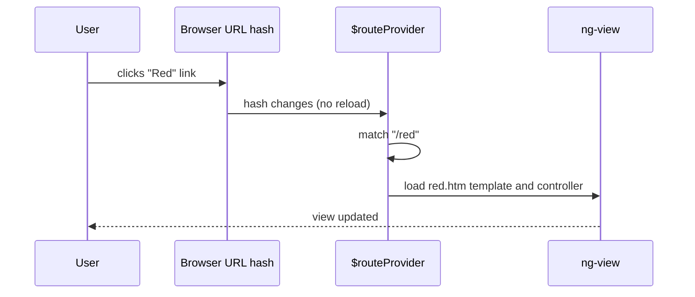

## 4.16 Digest Cycle ✅ (high-value theory)

**Digest cycle** is the process AngularJS uses to implement **two-way binding** by **dirty checking**.

**Point-wise working**
1. AngularJS keeps a **watch list** of variables used in the view (`$scope.$watch`).
2. When an event occurs (click, `$http` response, `$timeout`), AngularJS starts **`$digest`** inside the **Angular context**.
3. It **compares each watched value with its previous value** (**dirty checking**).
4. If a value changed, the **watch listener** is executed and the change is noted.
5. The listener may change other variables, so AngularJS **loops again**.
6. Loop **ends when no more changes** are found. Minimum **2 iterations**, maximum **10**; beyond that an **error** is thrown.
7. Finally the **DOM is updated**, and the browser renders it.

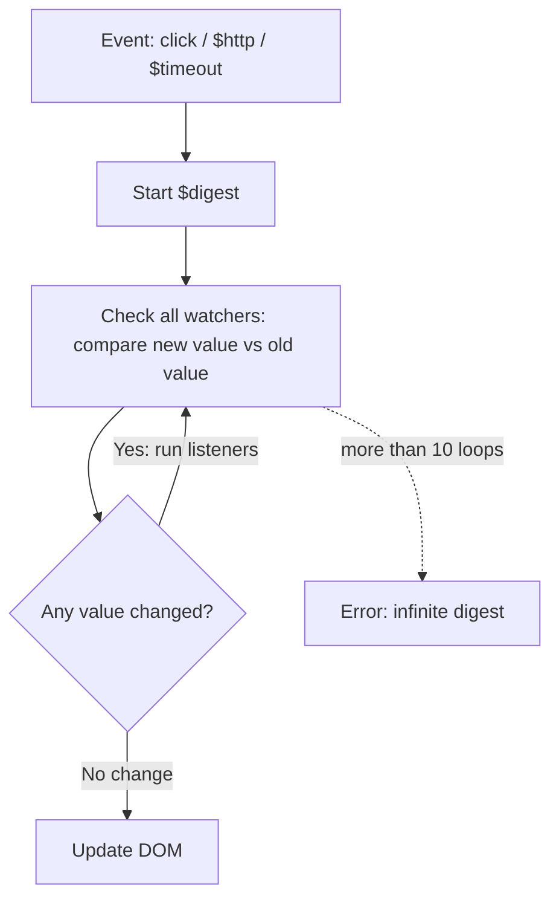

**Example (from PDF):** a change to `c` runs its listener, which modifies `a`. Cycle 1 updates `c`, cycle 2 detects `a`, cycle 3 finds no changes, then DOM updates.

📝 **EXAM TIP:** Mention "dirty checking", "watch list" and "max 10 iterations". These are the keywords examiners look for. Keep digest cycle ≈ 5 marks.

## 4.17 AngularJS vs Angular (2+) 🔴 MISSING NOTE (comparison added)

> [!WARNING]
> Your PDFs only cover AngularJS 1.x. The title slide says "Angular – REST web services" and some references point to `angular.io` (modern Angular), so a comparison question is possible. **Components, TypeScript, Angular CLI and `HttpClient` are not covered in your PDFs.**

| Point | AngularJS (1.x) | Angular (2+) |
|---|---|---|
| Language | JavaScript | **TypeScript** |
| Architecture | MVC / MVVM with `$scope` and controllers | **Component-based** |
| Mobile support | Not designed for it | Mobile-first |
| Data binding | Two-way by default (`ng-model`) | Property `[ ]`, event `( )`, two-way `[( )]` |
| Directives | `ng-click`, `ng-repeat` | `(click)`, `*ngFor`, `*ngIf` |
| HTTP | `$http` | **`HttpClient`** (Observables / RxJS) |
| Routing | `ngRoute` / `$routeProvider` | `RouterModule` |
| Dependency Injection | String-based, tied to Angular objects | Hierarchical, class constructor based |
| Tooling | Manual setup | **Angular CLI** (`ng new`, `ng serve`) |
| Performance | Digest cycle (slower on big pages) | Change detection (faster), AOT compile |
| Status | **End-of-life (Dec 2021)** | Actively maintained |

---

# 5. Integration: Full MEAN Flow 🔴 MISSING NOTE

> [!WARNING]
> "REST web services" is the title of `angular.pdf` but **no REST content exists** in your notes. **Mongoose** is also absent. A short integration section is added because MEAN questions often ask *"How do the four technologies work together?"*

**REST (Representational State Transfer)**: architectural style where resources are accessed through **URLs** using **HTTP methods**, exchanging **JSON**. It is **stateless**.

| HTTP method | URL | Action |
|---|---|---|
| GET | `/api/students` | List all |
| GET | `/api/students/:id` | Get one |
| POST | `/api/students` | Create |
| PUT | `/api/students/:id` | Update |
| DELETE | `/api/students/:id` | Delete |

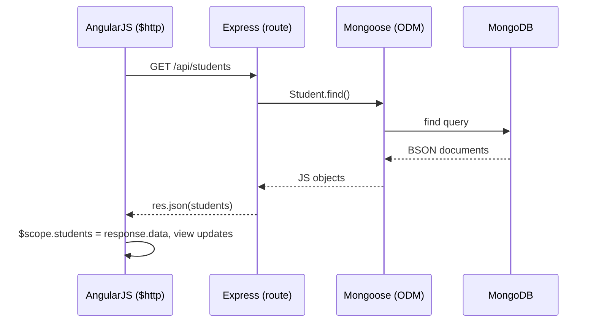

**Back end (Node + Express + Mongoose)** 🔴
```js
const express = require('express');
const mongoose = require('mongoose');
const app = express();
app.use(express.json());

mongoose.connect('mongodb://localhost:27017/college');
const Student = mongoose.model('Student', { name: String, course: String });

app.get('/api/students', async (req, res) => res.json(await Student.find()));
app.post('/api/students', async (req, res) => res.status(201).json(await Student.create(req.body)));

app.listen(3000);
```

**Front end (AngularJS)**
```html
<div ng-app="app" ng-controller="ctrl">
  <input ng-model="n.name"> <button ng-click="add()">Add</button>
  <ul><li ng-repeat="s in students">{{ s.name }}</li></ul>
</div>
<script>
  angular.module('app', []).controller('ctrl', function ($scope, $http) {
    $http.get('/api/students').then(r => $scope.students = r.data);
    $scope.add = () => $http.post('/api/students', $scope.n).then(r => $scope.students.push(r.data));
  });
</script>
```

**Mongoose** = **ODM (Object Data Modelling)** library. Adds **schemas, validation and models** on top of MongoDB's schema-less collections.

---

# 6. Master Comparison Tables

### 6.1 MEAN vs LAMP

| Point | MEAN | LAMP |
|---|---|---|
| Stack | MongoDB, Express, Angular, Node | Linux, Apache, MySQL, PHP |
| Language | **JavaScript** everywhere | PHP + SQL + JS |
| Database | NoSQL (document) | SQL (relational) |
| Server model | Non-blocking, single thread | Thread/process per request |
| Data format | JSON throughout | Conversion needed |
| Best for | Real-time apps, SPAs | Traditional websites, CMS |

### 6.2 MEAN vs MERN

| Point | MEAN | MERN |
|---|---|---|
| Front end | **Angular** (full framework, TypeScript) | **React** (library, JSX) |
| Learning curve | Steeper | Easier |
| Structure | Opinionated | Flexible |
| Binding | Two-way | One-way |

### 6.3 The four MEAN components

| Component | Layer | Language | Main job |
|---|---|---|---|
| MongoDB | Data | JS-style queries | Store documents |
| Express | Server | JavaScript | Routes, middleware, REST |
| Angular | Client | JS / TS | UI, binding, SPA |
| Node.js | Runtime | JavaScript | Execute JS on server |

---

# 7. Practical Assignment Answers (Node.js)

> [!NOTE]
> ⚠️ In your assignment sheet **Question 2 and Question 4 are identical**. One answer is given for both. Confirm with your teacher.

**Q1: Students folder with three records**
```js
const fs = require('fs');
if (!fs.existsSync('Students')) fs.mkdirSync('Students');
fs.writeFileSync('Students/student1.txt', 'Name: Asha, Roll: 101');
fs.writeFileSync('Students/student2.txt', 'Name: Ravi, Roll: 102');
fs.writeFileSync('Students/student3.txt', 'Name: Meera, Roll: 103');
```

**Q2 / Q4: Create `college.txt`**
```js
const fs = require('fs');
fs.writeFile('college.txt',
  'College: Fergusson College\nDepartment: Computer Science\nCourse: M.Sc. Computer Application', 
  err => { if (err) throw err; console.log('Created'); });
```

**Q3: Read, append name, display**
```js
const fs = require('fs');
fs.appendFile('college.txt', '\nName: Your Name', err => {
  if (err) throw err;
  fs.readFile('college.txt', 'utf8', (err, data) => console.log(data));
});
```

**Q5: Calculator module**
```js
// calculator.js
module.exports = {
  add: (a, b) => a + b,
  subtract: (a, b) => a - b,
  multiply: (a, b) => a * b,
  divide: (a, b) => b === 0 ? 'Cannot divide by zero' : a / b
};
// app.js
const calc = require('./calculator');
console.log(calc.add(10, 5), calc.divide(10, 2));
```

**Q6: `discount.js`**
```js
// discount.js
exports.calculate = function (price, percent) {
  const discount = price * percent / 100;
  return { discount: discount, finalPrice: price - discount };
};
// app.js
console.log(require('./discount').calculate(2000, 10));   // { discount: 200, finalPrice: 1800 }
```

**Q7: Two local modules + main program**
```js
// addition.js
module.exports = (a, b) => a + b;
// multiplication.js
module.exports = (a, b) => a * b;
// main.js
const add = require('./addition');
const mul = require('./multiplication');
console.log('Sum =', add(4, 5), ' Product =', mul(4, 5));
```

---

# 8. Likely 60-Mark Question Bank

| Marks | Question | Where |
|---|---|---|
| 10 | Explain MEAN stack architecture with diagram | §0 |
| 10 | Node.js architecture and event loop. Compare with Apache | §1.3 |
| 8 | Explain Node.js modules (types, export, example) | §1.5 |
| 8 | File system module with example | §1.8 |
| 6 | EventEmitter / Streams | §1.10, §1.12 |
| 8 | Express routing and middleware | §2 |
| 8 | SQL vs NoSQL, features of MongoDB | §3.1, §3.2 |
| 8 | CRUD operations in MongoDB with examples | §3.6 |
| 6 | Embedded vs normalized data modelling | §3.4 |
| 6 | Aggregation and indexing | §3.8, §3.9 |
| 6 | Replication / sharding | §3.10 |
| 8 | AngularJS features, MVC and MVVM | §4.2, §4.4, §4.5 |
| 8 | Directives, expressions, filters | §4.6–4.10 |
| 8 | Services (`$http`, `$timeout`, `$interval`) | §4.11 |
| 8 | Forms and validation | §4.13 |
| 6 | Routing in AngularJS | §4.15 |
| 5 | Digest cycle | §4.16 |
| 8 | Full REST flow in MEAN | §5 |

---

# 9. Short Notes (Quick Revision)

Each note is 3–5 lines. Write in this form for **short-note** questions.

**1. Node.js**
Open-source runtime that executes JavaScript on the server using the V8 engine. Single-threaded, event-driven and non-blocking, so it scales to many connections. Best for I/O-heavy and real-time apps.

**2. Event Loop** 🔴
Single thread that picks requests from the event queue. Simple tasks are done at once; blocking I/O goes to the thread pool and its callback is queued on completion. This enables non-blocking behaviour.

**3. Module / `module.exports`**
Reusable code in a separate file with its own scope (CommonJS). Types: core, local, third-party. `module.exports` exposes objects, functions or values; `require()` imports them.

**4. EventEmitter**
Class in the `events` module for custom events. `on()` registers a listener; `emit()` fires the event; `once()` runs the listener a single time.

**5. Streams**
Process data in chunks instead of loading it all. Four types: Readable, Writable, Duplex, Transform. Events: `data`, `end`, `error`, `finish`.

**6. Callback**
Function passed to another function and executed after the task completes. Node uses error-first callbacks, e.g. `fs.readFile(file, cb)`.

**7. Express.js** 🔴
Minimal web framework over Node. Provides routing, middleware, static file serving and templates. The "E" in MEAN.

**8. Middleware** 🔴
Function with `(req, res, next)` that runs in sequence before the route handler. Used for logging, body parsing and authentication.

**9. MongoDB**
Document-oriented NoSQL database storing BSON documents in collections. Dynamic schema, replication, auto-sharding, indexing.

**10. BSON**
Binary-encoded JSON used internally by MongoDB. Adds types such as Date, ObjectId and 64-bit integers, and is faster to parse.

**11. Embedded vs Normalized model**
Embedded keeps related data in one document (fast reads). Normalized splits data into separate documents joined by reference (less duplication).

**12. Aggregation**
Pipeline of stages (`$match`, `$group`, `$sort`) that computes results such as sum, average and count. Similar to SQL `GROUP BY`.

**13. Indexing**
Special structure on selected fields that speeds up reads. Costs extra space and slows writes. Created with `createIndex()`.

**14. Replication** 🔴
Copies data across servers in a replica set (one primary, many secondaries). Gives high availability through automatic failover.

**15. AngularJS**
Google's JavaScript framework for SPAs. Uses directives, two-way data binding, DI, MVC/MVVM, routing and services.

**16. `$scope`**
Object that acts as the Model and connects controller and view. Properties set on `$scope` are visible in the template.

**17. Two-way data binding**
Changes in the view update the model, and changes in the model update the view automatically through `ng-model` and the digest cycle.

**18. Directive**
`ng-` marker on a DOM element that adds behaviour. Examples: `ng-app`, `ng-model`, `ng-repeat`, `ng-click`.

**19. Filter**
Formats or selects data using the pipe `|`. Examples: `currency`, `uppercase`, `orderBy`, `filter`, `limitTo`.

**20. Service**
Singleton object reusable across the app and injected via DI. Built-in: `$http`, `$location`, `$timeout`, `$interval`.

**21. Routing (`ngRoute`)**
Switches templates inside one `ng-view` without page reload, configured through `$routeProvider`. Makes the app a SPA.

**22. Digest cycle**
Loop that dirty-checks watched values against old values and runs listeners until nothing changes (max 10 loops), then updates the DOM.

**23. Form validation states**
`$valid`, `$invalid`, `$pristine`, `$dirty`, `$touched`, `$untouched`. CSS classes `ng-valid`, `ng-invalid`, etc. are added automatically.

**24. REST API** 🔴
Stateless web service using HTTP methods (GET, POST, PUT, DELETE) on URLs and JSON data. In MEAN it links Angular and Express.

---

> **End of notes.** Items marked 🔴 were absent from your PDFs. Confirm them against your teacher's slides before the exam.
